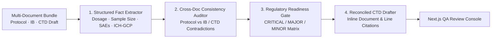

# Clinical Document Compliance & Cross-Doc Consistency Agent

[](https://github.com/mabdullah-ml/clinical-doc-compliance-agent/actions/workflows/ci.yml)
[](./LICENSE)
[](#)
[](#)

> 🌐 **[日本語ドキュメントはこちら (README.ja.md)](./README.ja.md)**

A domain-specific **Regulated Document Drafting & Cross-Document Consistency Verification Agent** designed for **Pharmaceutical (CTD / Investigator's Brochure / Study Protocol)** and **LegalTech** submission workflows. Uses 100% synthetic clinical trial documents (`AMX-402-P2`) to demonstrate auditable fact extraction, numerical/safety discrepancy detection, and citation-backed CTD drafting.

---

## Agent Pipeline



---

## Key Capabilities

- **Line-Cited Clinical Fact Extraction (`fact_extractor.py`):** Extracts compound IDs, clinical phase, sample size (`N=...`), dosing regimens (`mg`), Serious Adverse Event (SAE) counts, and ICH-E6 GCP references with exact document and line citations.
- **Automated Cross-Document Discrepancy Matrix (`consistency_checker.py`):** Compares secondary drafts (Investigator's Brochure, CTD Module 2.5) against the authoritative Study Protocol, flagging `CRITICAL` dosage/SAE safety mismatches, `MAJOR` sample-size contradictions, and `MINOR` missing regulatory attestations.
- **Reconciled CTD Module 2.5 Drafting:** Generates a clean, citation-backed Clinical Overview draft documenting every reconciled discrepancy for QA sign-off.
- **Full-Stack Next.js Review Workbench + Docker Compose:** Interactive UI where QA reviewers edit synthetic documents live, re-run audits, and watch the Regulatory Readiness Score update in real time.

---

## Quick Start

### 1-Command Docker Compose

```bash
docker compose up --build
```

- **QA Compliance Console (Next.js):** `http://localhost:3000`
- **FastAPI Swagger Docs:** `http://localhost:8000/docs`

### Run Tests Locally

```bash
# Backend
cd backend
pip install -r requirements.txt -r requirements-dev.txt
ruff check app tests
pytest -v

# Frontend
cd ../frontend
npm install
npm run typecheck
npm test
npm run build
```

---

## Author

**Abdullah Mamun, Ph.D.** — Senior Generative AI / LLM Engineer · Forward-Deployed AI Engineer · PMP  
[GitHub](https://github.com/mabdullah-ml) · [LinkedIn](https://www.linkedin.com/in/mamunabdullah01)
